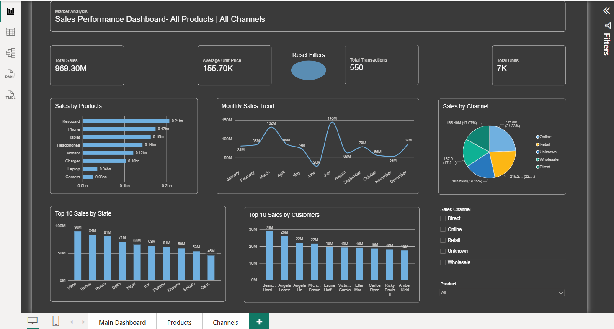
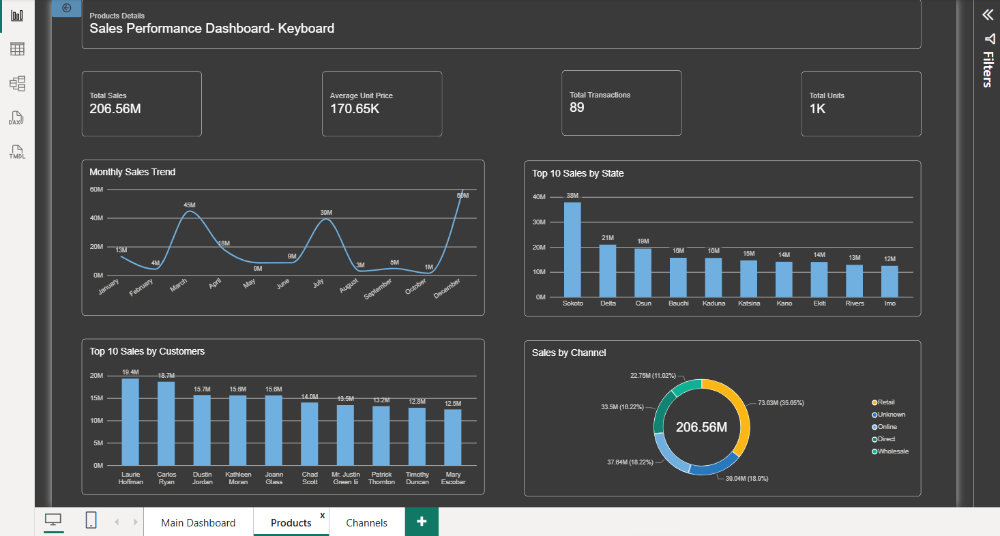
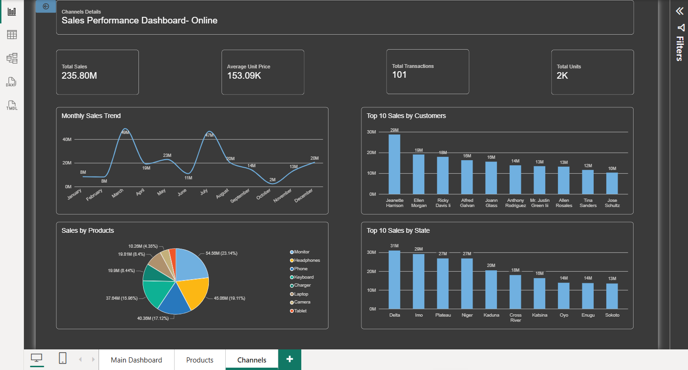
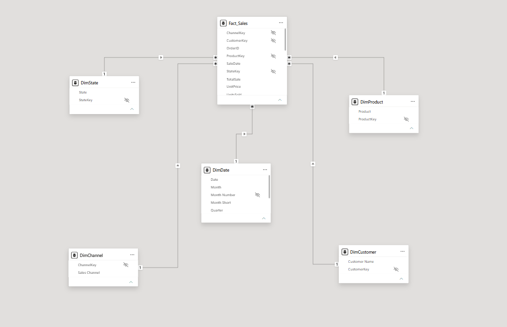

# Nigeria Messy Sales Dashboard | Power BI

An end-to-end Power BI sales analytics project built around a messy Nigeria sales dataset. The project focuses on data cleaning and transformation, dimensional modeling, DAX measures, and interactive sales reporting.

> **Data-source note:** The original Power Query currently points to `C:\Users\ASUS\Downloads\nigeria_messy_sales_dataset.csv`. This is a machine-specific path. Before refreshing on another computer, update the `stg_Sales` query to the location where you store the CSV. Only publish the dataset if you have permission to share it and it contains no sensitive information.

## Dashboard previews

### Main dashboard


### Product details


### Sales channel details


### Data model


## Project objectives

- Clean inconsistent and messy sales data with Power Query.
- Build a semantic model using fact and dimension tables.
- Create DAX measures for sales performance, transactions, units, customers, and time-based analysis.
- Explore sales by product, customer, state, sales channel, and date.
- Present key performance indicators in an interactive report.

## Tools and skills

- **Microsoft Power BI Desktop** — report development and data modeling
- **Power Query (M)** — transformation and data preparation
- **DAX** — measures and time intelligence
- **Dimensional modeling** — fact and dimension tables
- **Git/GitHub** — version control and project documentation

## Repository structure

```text
PowerBI-Nigeria-Messy-Sales-Dashboard/
├── README.md
├── .gitignore
├── Documentation/
│   └── PROJECT_OVERVIEW.md
├── PowerBI/
│   ├── PowerBI-Nigeria-Messy-Sales-Dashboard.pbix
│   ├── PowerBI-Nigeria-Messy-Sales-Dashboard.pbip
│   ├── PowerBI-Nigeria-Messy-Sales-Dashboard.Report/
│   └── PowerBI-Nigeria-Messy-Sales-Dashboard.SemanticModel/
└── Screenshots/
    ├── Main-Dashboard.png
    ├── Products-details.png
    ├── Channel-details.png
    └── Data_Model.png
```

## How to open the project

1. Install a recent version of **Power BI Desktop**.
2. Clone or download this repository.
3. Open `PowerBI/PowerBI-Nigeria-Messy-Sales-Dashboard.pbix` to view the packaged report, or open the `.pbip` project in Power BI Desktop for the project-source structure.
4. To refresh the data, open **Transform data** and edit the source in the `stg_Sales` query so it points to your local copy of `nigeria_messy_sales_dataset.csv`.
5. Select **Close & Apply**, then refresh and verify the report.

The CSV dataset is not included in this repository. Add it only if redistribution is permitted; otherwise document where it can be obtained.

## Data model and measures

The semantic model includes a `Fact_Sales` table and dimensions for customer, product, state, sales channel, and date. Measures in the model include:

- Total Sales
- Total Units
- Total Transactions
- Unique Customer
- Average Unit Price
- Sales YTD / MTD
- Previous Month Sales / Previous Year Sales
- Sales Data Completeness %
- Product and Customer Sales Rank

**Validation note:** Review the definition of `YOY Sales Growth` and `MOM sales growth` in the model before presenting them as year-over-year and month-over-month metrics. The current definitions both compare against previous-month sales, so the YOY measure should be corrected if year-over-year growth is intended.

## Before publishing

- [ ] Replace the machine-specific CSV path with your own data-source path.
- [ ] Verify the report refreshes successfully on your machine.
- [ ] Check that dataset sharing is allowed and no personal or confidential data is exposed.
- [ ] Confirm KPI definitions and formatting, especially YOY vs. MOM growth.
- [ ] Keep `.pbi/localSettings.json` and `.pbi/cache.abf` out of version control.
- [ ] Add any source attribution or dataset license required by the original data provider.

## Disclaimer

This repository is intended as a portfolio and learning project. Findings depend on the dataset, its quality, and the definitions used in the report.
